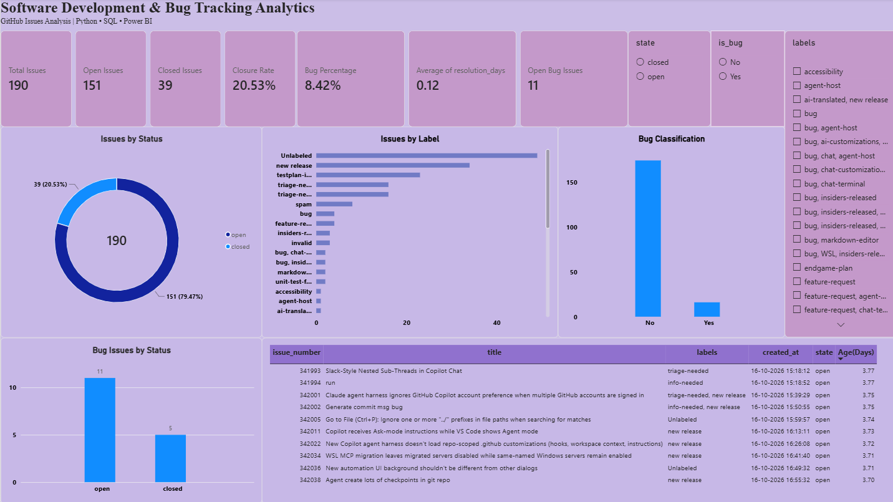
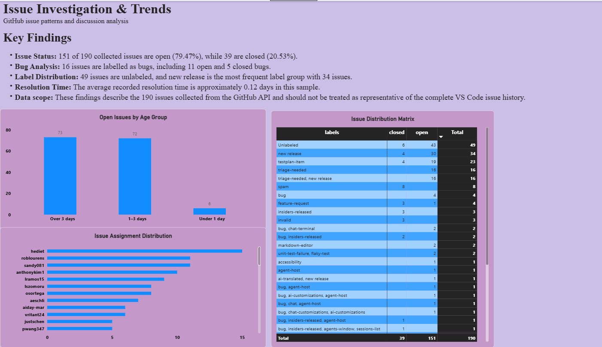

# Software Development & Bug Tracking Analytics

## Project Overview
An end-to-end data analytics project that analyzes GitHub issues from the Microsoft VS Code repository. The project uses Python for data collection and cleaning, SQL for querying and analysis, and Power BI for interactive dashboard development.

## Objectives
- Analyze open and closed issues.
- Identify issues labelled as bugs.
- Explore issue label distribution.
- Examine issue age and assignment patterns.
- Calculate issue closure rate and resolution time.

## Tools & Technologies
- **Python:** Data collection, cleaning, and preparation
- **Pandas:** Data manipulation
- **GitHub REST API:** Source of issue data
- **SQL / SQLite:** Data storage and analysis
- **Power BI:** Dashboard creation and visualization

## Project Workflow
1. Collected GitHub issue data using the GitHub REST API.
2. Cleaned the dataset by removing duplicates, handling missing values, and preparing date columns.
3. Classified issues using their labels and calculated resolution time.
4. Loaded the cleaned dataset into SQLite.
5. Wrote SQL queries to analyze issue status, bug counts, labels, issue age, and closure rate.
6. Built Power BI dashboards to visualize the findings.

## Key Findings
- **Total issues analyzed:** 190
- **Open issues:** 151
- **Closed issues:** 39
- **Closure rate:** 20.53%
- **Issues labelled as bugs:** 16
- **Average recorded resolution time:** Approximately 0.12 days

## Dashboard Pages
### 1. Overview
Displays key performance indicators, issue status, label distribution, bug classification, and bug status.

### 2. Insights & Analysis
Explores open issue age groups, assignment distribution, and issue distribution by label and status.

## Data Scope and Limitations
The analysis uses 190 issues collected from the GitHub API. This is a limited sample, not the complete historical issue dataset for VS Code. Findings should be interpreted within this sample. Resolution-time calculations apply to issues with recorded closure timestamps.

## Files
- `fetch_github_data.py` — Collects GitHub issue data
- `clean_github_data.py` — Cleans and prepares the dataset
- `load_to_sql.py` — Loads cleaned data into SQLite
- `sql_analysis.py` — Runs SQL analysis queries
- `github_issues.csv` — Raw dataset
- `github_issues_cleaned.csv` — Cleaned dataset
- `software_analytics.db` — SQLite database
- `Software_Development_Bug_Tracking_Analytics.pbix` — Power BI report

## Skills Demonstrated
Python, Pandas, REST APIs, SQL, SQLite, data cleaning, exploratory data analysis, KPI analysis, and Power BI dashboard development.

## Power BI Dashboard

### Dashboard Overview

### Insights & Analysis

